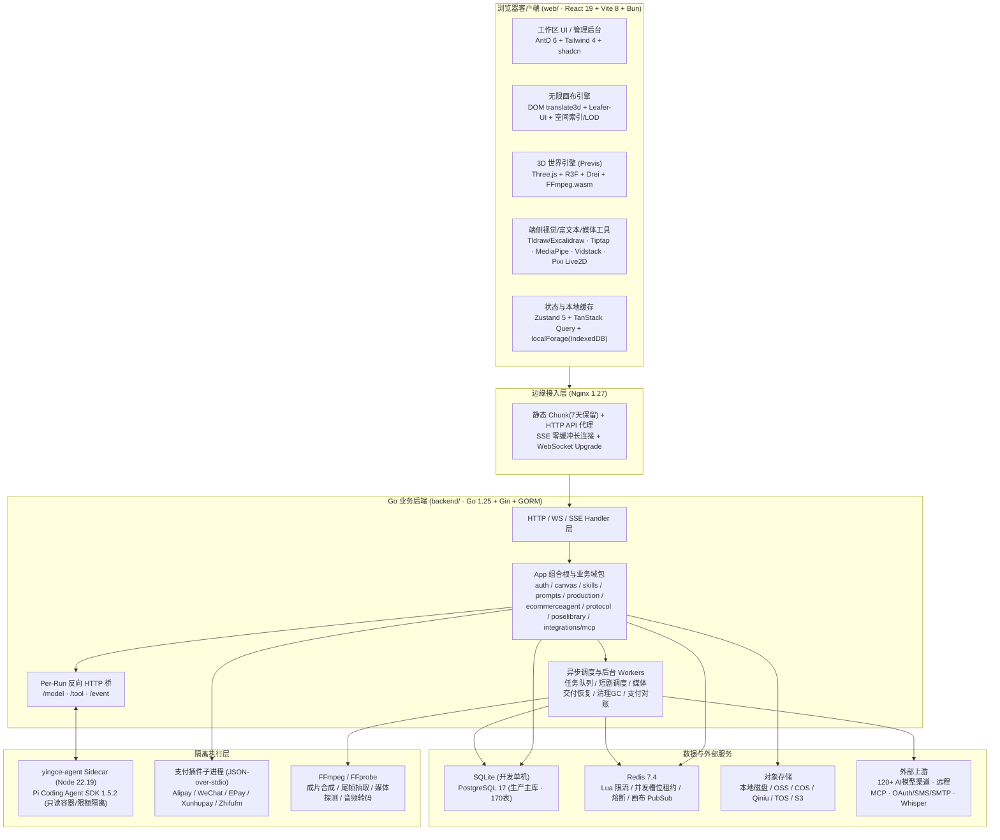
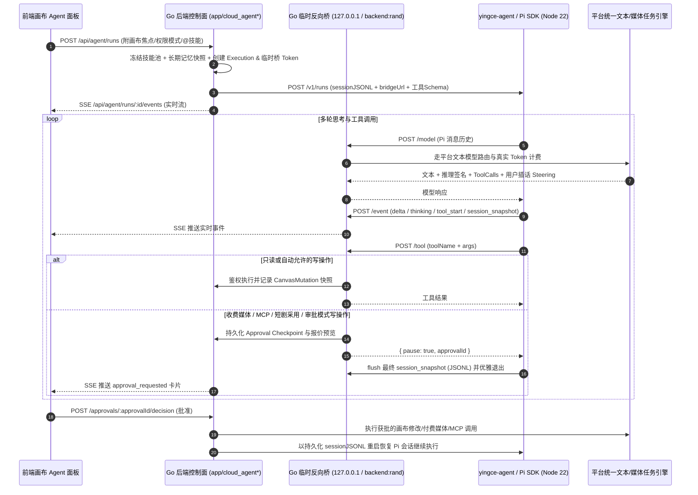
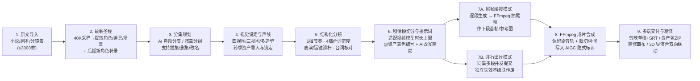
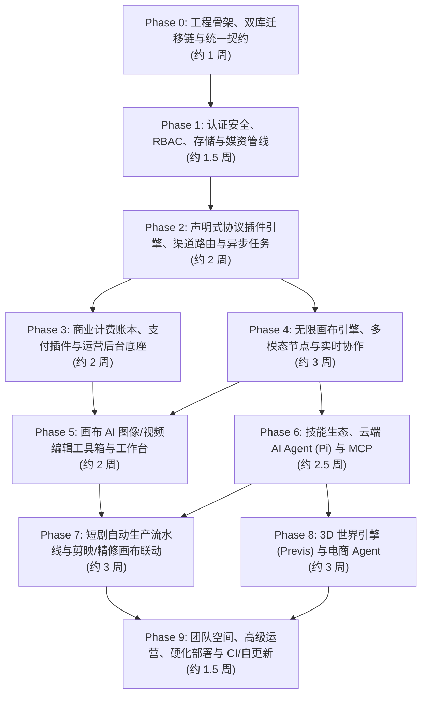

# AI 影视与多模态无限画布工作台完整开发流程方案
> 参考项目：`ddcat-ai/open-ai-canvas`（影策） · 目标：提供可直接落地的架构设计、技术选型与第三方依赖矩阵、全量功能实现详设及分阶段开发路线图，支持从零复刻等价功能。

---

## 1. 项目全景与总体系统架构

### 1.1 系统定位与核心能力矩阵
本方案复刻的是一套**开源、可自部署、具备商业化闭环的 AI 影视与多模态创作工作台**，覆盖 14 大核心业务子系统：

1. **无限画布引擎**：自研高性能 DOM + `leafer-ui` 双层矢量画布，支持 13 类内置节点 + 插件节点、连线策略、空间索引裁剪、3 级 LOD、双轨撤销重做与 WebSocket 多窗口实时协作。
2. **画布多模态 AI 加工工具**：局部重绘、自由标注、图内文字 OCR 替换、宫格切分、无损旋转、多角度/机位/打光/超分、AI 图层拆分、人脸表情控制、姿势库、浏览器端 FFmpeg.wasm 视频剪辑/合并/抽帧、视频复刻、相对深度视频、节点媒体版本历史（V1–V30）。
3. **3D 世界引擎（Previs 预演台）**：Three.js + R3F 构建的 3D 导演台与动画时间轴，含 63 种参数化道具、7 套程序化城市场景、21 姿势 / 21 动作 / 8 种移动轨迹、25 种运镜 / 15 套大师配方、物理天空与 7 种天气、A/B 地面标记，可导出构图、白模 MP4 与定标深度视频回写画布。
4. **短剧自动生产流水线**：上传小说/剧本/分镜表 → 故事圣经 → 自动拆集 → 角色/道具/场景设定（四视图/三视图/多造型/声线/跨季复用）→ 结构化分镜（5 档节奏、表演/运镜滑杆、台词核对）→ 剧情段切分 → 尾帧续接 / 并行出片 → FFmpeg 成片合成（含 AIGC 隐式标识）→ 剪映草稿 + SRT / 资产包导出 → 精修画布双向同步。
5. **云端 AI Agent 与记忆系统**：基于 Node/Pi SDK + 独立 `yingce-agent` Sidecar + Go 反向 HTTP 桥的云端智能体，内置 41 个注册工具、审批 Checkpoint 暂停恢复、双层上下文压缩、画布逐步撤销、长期记忆文档、历史对话召回及 Live2D/动画助手形象。
6. **MCP 协议安全接入**：基于官方 Go MCP SDK 接入 `streamable_http` / `sse` 远程 MCP 服务，支持个人/平台/市场三级隔离、渐进式工具发现、每工具 Schema 策略与防重复外调回执。
7. **技能生态与在线工作台**：73 套内嵌创作技能 + ZIP/GitHub 导入与定时同步 + CodeMirror 在线多文件 Skill IDE + 技能策展 + 运行时按需检索注入。
8. **电商 Agent 与离线知识库**：5 步电商出图流、36 个海内外电商平台规则与合规门禁、14,740 条离线知识库（零向量库）、61 个电商技能、64,292 节点双语类目树、8%–92% 排版安全区与区域选角。
9. **统一多模态声明式插件引擎**：`.yingce-plugin` ZIP 规范、JSON 表达式 DSL、10 种鉴权策略、同步流式/异步轮询/解耦慢轮询、122 个官方模型协议包、逻辑模型族路由与防双扣费故障转移。
10. **异步任务调度与媒资存储管线**：4 层并发控制、DB 租约 Fencing、SSE 游标断线续传、5 大对象存储后端（本地/阿里云 OSS/腾讯云 COS/七牛/火山 TOS/通用 S3）+ 故障落盘异步 Offload + 引用保护 GC + 官方素材库/火山方舟素材库。
11. **创作首页、图片/视频工作台、灵感大厅与任务中心**：统一多模态对话（跨设备增量同步）、电商场景批量工作台、纵深灵感画廊、全站完成通知与 Web Audio 提示音。
12. **团队空间与多租户隔离**：公司 → 小组二级空间、公共积分池与成员额度划拨、跨空间素材发布、团队画布与任务隔离。
13. **完整商业化计费与支付体系**：微积分定点账本（`1 credit = 1,000,000 microcredits`）、4 大计费模型（固定次/图片用量/视频 Token 与参考视频/分时+上下文阶梯 Token）、多币种与用户分组倍率、JSON-over-stdio 支付插件运行时（支付宝/微信/易支付/虎皮椒/支付FM）、推广返佣、存储空间扩容套餐与 7 天宽限期只读守卫、兑换码与签到。
14. **自部署管理后台与安全自更新运维**：40+ 管理页（分析/流量/日志/渠道/模型/用户/财务/运营/插件/MCP/技能/电商/设置）、Nginx SSE/WS 零缓冲路由、旧前端 Chunk 7 天保留、无 `docker.sock` 的 Host-Updater 原子升级与自动回滚。

### 1.2 总体技术架构图



### 1.3 仓库目录结构规范与依赖铁律

```text
project-root/
├── web/                              # 前端 SPA（Bun + Vite 8 + React 19 + TS 7）
│   ├── public/                       # 静态资源（live2d core, mediapipe wasm, inspirations, themes）
│   └── src/
│       ├── pages/                    # 路由页面与页面私有 hook/组件（仅协调流程，不拼后端协议）
│       ├── layouts/                  # 路由布局壳（UserLayout / AdminShell / AuthScene）
│       ├── components/               # 跨页复用组件（canvas/, previs/, mcp/, skills/, ui/）
│       ├── services/api/             # 唯一 HTTP 业务调用层（统一走 http 信封解包）
│       ├── services/                 # 跨页副作用（sync, blob-cache, live2d, realtime, export）
│       ├── stores/                   # Zustand 持久化状态（大对象走 user-scoped localforage）
│       ├── lib/                      # 纯函数算法（画布几何/布局/LOD、短剧规则、Previs 数学、计价）
│       └── themes/                   # 主题皮肤包（如龙影水墨、云鹤仙观）
├── backend/                          # Go 1.25 后端
│   ├── cmd/                          # 可执行入口：server, migrate-schema, migrate-sqlite-postgres,
│   │                                 # host-updater, ecommerce-knowledge, payment-*, reseed-*
│   ├── agent-runtime/pi/             # Node Pi SDK 执行脚本（agent-runtime.mjs）
│   ├── builtin/                      # 73 个 Go embed 内置创作技能包
│   ├── payment-sdk/ & payment-plugins/ # 支付 RPC SDK 与 5 大网关实现
│   ├── third_party/go-sms-sender/    # 带 SSRF 补丁的短信发送库
│   └── internal/
│       ├── handler/                  # HTTP/WS/SSE 入参解析、鉴权、统一响应 {code,data,msg,reason}
│       ├── service/                  # 稳定导出别名层（aliases_*.go），防上层耦合
│       ├── app/                      # 组合根与跨域编排
│       ├── <domain>/                 # 独立域包：auth, canvas, assets, skills, prompts, production,
│       │                             # jianying, protocol, generation, outbound, platform, kernel,
│       │                             # agent, agentcontext, integrations/mcp, ecommerce*, poselibrary,
│       │                             # inspirations, payment, storage, sms, tools, workbench, hostupdate
│       ├── repository/               # GORM 数据访问与事务操作（不承载业务策略）
│       ├── model/                    # 数据模型与枚举
│       └── database/                 # 双驱动连接池与 v1~v109 + 扩展链迁移
├── yingce-agent/                     # 生产独立 Agent 容器（Node 22.19 HTTP 准入服务）
├── plugin-packages/                  # 122 个声明式模型协议包 + 5 个支付插件包及打包脚本
├── docker/ & docker-compose.*.yml    # 开发/本地/生产部署编排 + nginx.conf
└── scripts/                          # 安装、Host-Updater、Whisper、推送前并行校验脚本
```

> [!IMPORTANT]
> **架构分层硬约束（防后期腐化）**
> 1. **后端调用单向链**：`HTTP -> handler -> service(别名) -> app(组合根) -> 业务域包 -> repository/model`。**已抽出的业务域包严禁反向 import `app` 或 `service`**，并通过 `internal/agent/architecture` 架构单元测试自动守护。
> 2. **前端唯一业务入口**：全部业务 JSON 走 `web/src/services/api/request.ts` 导出的 `http`（自动解包 `{ code, data, msg, reason }`，仅用 `ApiError.reason`/`code` 判定错误，禁止解析 `msg`）；自定义渠道中转统一走 `channel-transport.ts`；多账号切换必须隔离 React Query、localForage 与资源 Blob 缓存。
> 3. **写路径强校验**：生成、审批、删除、扣费、配额、权限操作禁止静默降级或默认兜底；素材删除前必查全业务引用。

---

## 2. 完整技术栈与第三方依赖清单

### 2.1 前端核心与第三方库（基于 `web/package.json` 源码核实）

| 分类 | 技术 / 第三方库 | 参考版本 | 在本项目中的精确实现用途与说明 | 必需级别 |
| :--- | :--- | :--- | :--- | :--- |
| **构建与运行时** | **Bun** + **Vite** + **TypeScript** + **React** | `bun 1.3.9` / `vite 8.1.5` / `ts 7.0.2` / `react 19.2.7` | 包管理、构建、单测（`bun test`）、类型检查与核心 UI 运行时 | 必需 |
| **路由** | **react-router** | `^8.2.0` | 用户工作区、团队空间（带作用域重载守卫 `redirectDocument`）、公开分享、管理后台全路由 + 懒加载预取 | 必需 |
| **UI 组件与样式** | **antd** + **@ant-design/icons** + **lucide-react** + **@lobehub/icons** | `antd 6.5.1` / `lucide 1.25.0` / `lobehub 5.16.0` | 主体表单/弹窗/抽屉/表格/管理后台（397 文件）、通用线框图标、AI 模型品牌原色 Logo | 必需 |
| **原子样式与底座** | **tailwindcss** + **shadcn** + **cva** + **clsx** + **tailwind-merge** + **tw-animate-css** + **react-aria-components** | `tailwind 4.3.3` / `shadcn 4.13.1` | 语义三层 Token（Primitive → Semantic → Component）、画布浮层/工具条/轻量基础控件与无障碍交互 | 必需 |
| **动效** | **motion**（Framer Motion） | `^12.42.2` | 画布工具栏、Agent 面板、缩放读数、节点入场与创作首页拖拽排序动画（尊重 `prefers-reduced-motion`） | 推荐 |
| **状态与请求** | **zustand** + **@tanstack/react-query** + **axios** | `zustand 5.0.14` / `rq 5.101.2` / `axios 1.18.1` | 跨页客户端状态（25 Store）、服务端缓存与轮询（91 文件）、带 `withCredentials` 拦截器的统一 HTTP 底座 | 必需 |
| **虚拟滚动** | **@tanstack/react-virtual** | `^3.14.8` | 短剧制作台海量原著章节选择器（上限 3,000 章）与分集侧栏列表虚拟化 | 必需 |
| **无限画布 2D 矢量** | **leafer-ui** | `^2.2.7` | **主无限画布的 2D 矢量底层与覆盖层**：底层绘制最多 5,000 条贝塞尔连线（缩放期光栅预览缓存），顶层绘制框选矩形、多选外框与吸附对齐线 | 必需 |
| **嵌入白板引擎** | **tldraw** + **@excalidraw/excalidraw** | `tldraw 5.2.5` / `excalidraw 0.18.1` | **注意：并非主画布引擎！** 仅作为画布内 `drawing`（绘图/涂鸦）节点的可插拔双白板引擎（后台可切换，`tldraw` 生产需配置 License Key） | 可选（可二选一） |
| **3D 世界引擎** | **three** + **@react-three/fiber** + **@react-three/drei** + **three-stdlib** | `three 0.185.1` / `r3f 9.6.1` / `drei 10.7.7` | 1) 影策 3D 预演台（Previs）全场景渲染、GLTF/GLB 骨骼加载（`GLTFLoader` + `SkeletonUtils`）、物理天空、操控轴；2) 人脸情绪 3D 控制球；3) `/welcome` 3D 故事胶片页 | 必需（做 3D 引擎时） |
| **端侧视频处理** | **@ffmpeg/ffmpeg** + **@ffmpeg/core** + **@ffmpeg/util** | `0.12.15` / `0.12.10` | 浏览器 WASM 串行单任务队列（空闲 30s 自动释放）：Previs WebM 转固定帧率 MP4、画布多段视频合并、视频裁段与音轨提取 | 必需 |
| **端侧视觉/识脸** | **@mediapipe/tasks-vision** | `^1.0.1` | 独立 Web Worker 加载本地 WASM 与 `blaze-face-full-range-sparse.tflite`，检测图片人脸框供表情/情绪编辑器使用 | 可选（表情编辑功能） |
| **视频播放器** | **@vidstack/react** | `1.15.6` | 统一封装视频播放组件，服务于画布视频节点、短剧制作台、工作台画廊与任务中心 | 必需 |
| **富文本编辑器** | **@tiptap/react** + `@tiptap/starter-kit` 等 10 包 | `3.28.0`（锁定版本） | 画布文本节点富文本编辑、管理后台横幅公告标题富文本编辑 | 必需 |
| **代码/提示词编辑器** | **@uiw/react-codemirror** + **@codemirror/lang-json** | `4.25.11` / `6.0.2` | 在线技能工作台（Skill IDE）多文件编辑器、后台提示词模板编辑器 | 必需 |
| **AI 流式 Markdown** | **streamdown** + **@streamdown/code** + **react-markdown** + **remark-gfm** + **@ant-design/x** | `streamdown 2.5.0` / `antdx 2.9.0` | Agent 与创作对话流式 Markdown 渲染与代码高亮；`@ant-design/x` 用于提示词优化抽屉 | 必需 |
| **Live2D 形象渲染** | **pixi.js** + **pixi-live2d-display** + 自托管 `live2dcubismcore.min.js` | `pixi 6.5.10` / `0.4.0` | 动态按需加载 Cubism 3/4 Live2D ZIP 助手模型（限 30fps，单 WebGL 槽位调度，无外部 CDN） | 可选（助手皮肤） |
| **本地持久化与压缩** | **localforage** + **idb** + **fflate** + **file-saver** + **json-canonicalize** | `localforage 1.10` / `idb 8.0.3` / `fflate 0.8.3` | 按账号隔离的 IndexedDB 持久化（画布/绘图/资源 Blob 缓存）、浏览器端 ZIP 打包解压（画布工程与短剧资产包）、本地运行时密钥库、规范 JSON 哈希 | 必需 |
| **图表/CSV/国际化** | **recharts** + **papaparse** + **i18next** + **react-i18next** + **dayjs** + **nanoid** | `recharts 3.9.2` / `i18next 26.7.1` | 后台用量与流量趋势图、流量 CSV 导出、6 语言同步包（`zh-CN/en-US/fr-FR/de-DE/ja-JP/ko-KR`） | 必需 |

> [!NOTE]
> **源码核实避坑提示**：
> - 原仓库 `web/package.json` 声明了 `mammoth`，但经源码全量检索**实际未导入使用**，复刻时无需引入（除非你需要 `.docx` 客户端解析）。
> - 主无限画布**切勿直接基于 `tldraw` 构建全套节点**，参考项目采用**自定义 DOM 节点容器 + `leafer-ui` 矢量层**方案，才能支撑高并发视频/富文本/表格/分镜复合节点与细粒度 LOD 性能控制。

### 2.2 后端 Go 核心与第三方库（基于 `backend/go.mod`）

| 分类 | 技术 / 第三方库 | 参考版本 | 精确用途 |
| :--- | :--- | :--- | :--- |
| **语言与 Web 框架** | **Go** + **github.com/gin-gonic/gin** | `Go 1.25.0` / `gin 1.12.0` | 主 HTTP 服务、中间件、SSE 流式输出、路由分组 |
| **ORM 与双数据库** | **gorm.io/gorm** + **gorm.io/driver/postgres** + **github.com/jackc/pgx/v5** + **gorm.io/driver/sqlite** + **modernc.org/sqlite** | `gorm 1.31.2` / `pgx 5.10.0` | 生产用 PG（pgx v5 连接池 + 行锁/咨询锁）；本地用 CGO SQLite（WAL 模式）；单测用纯 Go `modernc.org/sqlite` |
| **分布式协调** | **github.com/redis/go-redis/v9** | `v9.22.0` | Lua 滑动/固定窗限流、Lua ZSET 并发槽位租约、渠道熔断、路由缓存版本失效、画布协作 Pub/Sub 与设备编号 |
| **实时通信** | **github.com/coder/websocket** | `v1.8.15` | 画布多窗口实时协作 WebSocket（同账号多设备在线状态、远端光标、拖拽轮廓与变更通知） |
| **MCP 协议** | **github.com/modelcontextprotocol/go-sdk** + **github.com/google/jsonschema-go** | `v1.8.0` / `v0.4.3` | 远程 MCP Client（`streamable_http` / `sse` 传输）、本地 JSON Schema 校验（禁用远程 `$ref` 拉取） |
| **认证与密码学** | **github.com/coreos/go-oidc/v3** + **golang.org/x/oauth2** + **golang.org/x/crypto** | `v3.21.0` / `0.36.0` / `0.54.0` | 通用 OIDC（PKCE S256）、Linux.do/微信 OAuth、bcrypt 密码哈希、AES-256-GCM 密钥落盘加密 |
| **对象存储多云 SDK** | **aws-sdk-go**（通用 S3）、**tencentyun/cos-go-sdk-v5**（腾讯 COS）、**qiniu/go-sdk/v7**（七牛）、**volcengine/volc-sdk-golang**（火山 TOS & V4 签名）、自研阿里云 OSS V1 签名 | 见 `go.mod` | 5 大云存储 + 本地磁盘统一抽象，支持平台级与用户自有 OSS 切换 |
| **短信与媒体识别** | **github.com/casdoor/go-sms-sender**（本地 `third_party/` 打补丁注入 SSRF 传输层）、**gabriel-vasile/mimetype**、**golang.org/x/image** | `v0.25.0` / `v1.4.13` | 阿里云/腾讯云短信发送、上传文件 MIME 魔数嗅探、缩略图/尺寸/图片压缩处理 |

### 2.3 Agent 运行时与外部系统组件

| 组件 | 技术 / 依赖 | 版本 | 精确用途 |
| :--- | :--- | :--- | :--- |
| **Cloud Agent Runtime** | **Node.js** + **@earendil-works/pi-ai** + **@earendil-works/pi-coding-agent** + **typebox** + **undici** | `Node 22.19` / `pi 1.5.2` / `typebox 1.3.27` / `undici 7.28.0` | 执行多轮工具调用会话、Session JSONL 持久化与原生上下文压缩；本地嵌入启动，生产运行在独立 `yingce-agent` 只读硬化容器中 |
| **服务端音视频引擎** | **FFmpeg** + **FFprobe**（Alpine 包） | 系统最新稳定版 | 媒体元信息探针（远程仅探前 8MiB）、短剧尾帧抽取（`-sseof -1`）、成片拼接渲染与 AIGC 元数据写入、非标视频转码、提取 16kHz WAV |
| **语音字幕转写（可选）** | **whisper.cpp** HTTP 服务 | 独立进程 `:8082` | 接收 `POST /inference` WAV 上传返回 `verbose_json` 时间轴字幕 |
| **基础设施** | **PostgreSQL 17** + **Redis 7.4 (AOF)** + **Nginx 1.27** | Alpine 镜像 | 生产持久化存储、协调服务、静态托管与 SSE/WS 反向代理 |

### 2.4 第三方外部服务生态
- **AI 模型供应商**：支持 120+ 协议包（OpenAI / Anthropic / Google Gemini & Vertex / AWS Bedrock / 火山方舟 Seedream & Seedance / 阿里百炼 Wan & Qwen / MiniMax H3 & Speech / 可灵 Kling / 腾讯混元 / 智谱 / DeepSeek / Kimi / Runway / Luma / Flux / Replicate / Fal / Midjourney 中转 / AutoDL ComfyUI / RunningHub / Ollama / vLLM 等）。
- **身份与风控**：通用 OIDC、Linux.do OAuth、微信网站应用扫码登录、Cloudflare Turnstile 人机校验、SMTP 邮件服务、阿里云/腾讯云短信。
- **商业支付**：支付宝网页支付（RSA2）、微信 Native（APIv3 + AEAD_AES_256_GCM）、易支付（MD5/RSA2，含多币种与多渠道）、虎皮椒、支付 FM。
- **生态协作**：火山方舟实人认证 H5（人脸活体）、Eagle 本地桌面资产库（`127.0.0.1:41595`）、LibTV / TapNow 画布导入、飞书反馈机器人事件。

---

## 3. 数据层架构与完整数据库 Schema 设计

### 3.1 双数据库驱动与 Redis 边界原则
1. **数据单一事实源**：数据库（SQLite/PG）承载 100% 业务状态（任务、账本、配额、权限、画布、短剧、Agent 会话）。
2. **双驱动差异处理**：
   - **SQLite（本地开发）**：启用 `WAL`、`_busy_timeout=5000`、`_foreign_keys=on`；为 `tasks` / `api_call_logs` 增加整型 `created_at_epoch` 索引列加速时间范围查询；写并发采用短事务 + 条件 CAS。
   - **PostgreSQL（生产多实例）**：`pgx/v5` 连接池（`MaxOpen=30, MaxIdle=10`）、默认 `idle_in_transaction_session_timeout=5min`；任务抢占使用 `SELECT ... FOR UPDATE SKIP LOCKED`；迁移、上传配额、Agent 准入使用 `pg_advisory_xact_lock`。
3. **Redis 严格限定为瞬态协调层**（PG 模式必选，SQLite 模式自动退化为内存互斥锁）：
   - `canvas:rate:<key>`：Lua 固定窗限流；
   - `canvas:slots:<scope>`：Lua ZSET 分布式并发槽位租约（全局 Worker、渠道并发、MCP 并发、后台任务）；
   - `canvas:circuit:*` & `canvas:logical-model-route-catalog:version`：渠道熔断与路由表跨实例失效；
   - `canvas:realtime:<room>`：画布多窗口协作 Pub/Sub 与设备号 ZSET 租约。
4. **版本化迁移链**：
   - 主链 `schema_migrations`（v1 → v109，带 SHA-256 校验，生产禁自动迁移，通过独立 `migrate` 容器执行 `migrate-schema up` + `verify`）；
   - 独立扩展链 `yingce_schema_migrations`（v1 → v4，承载官方素材库扩展表）；
   - 独立迁移工具 `migrate-sqlite-postgres`：预检 UTF-8 长度限制，在**单个 PG 事务内**完成建表、批量导入、逐字段反射等价校验与前缀 ID 序列对齐。

### 3.2 核心领域 ER 关系图

```mermaid
erDiagram
    USERS ||--o{ AUTH_SESSIONS : has
    USERS ||--o| CREDIT_ACCOUNTS : owns_personal
    USER_GROUPS ||--o{ USERS : assigns
    USER_GROUPS ||--o{ USER_GROUP_CHANNELS : allows
    TEAMS ||--o{ TEAM_MEMBERSHIPS : contains
    TEAMS ||--o| CREDIT_ACCOUNTS : owns_pool
    TEAM_MEMBERSHIPS ||--o| CREDIT_ACCOUNTS : owns_member_quota

    CHANNEL_WEBSITES ||--o{ MODEL_CHANNELS : groups
    MODEL_CHANNELS ||--o{ CHANNEL_MODELS : exposes
    CHANNEL_MODELS ||--o{ CHANNEL_MODEL_PRICE_TIERS : prices
    LOGICAL_MODELS ||--o{ LOGICAL_MODEL_REVISIONS : versions
    LOGICAL_MODELS ||--o{ LOGICAL_MODEL_ROUTES : routes_to
    CHANNEL_MODELS ||--o{ LOGICAL_MODEL_ROUTES : backs

    USERS ||--o{ CANVAS_PROJECTS : owns
    CANVAS_PROJECTS ||--o{ CANVAS_SNAPSHOTS : versions
    CANVAS_PROJECTS ||--o{ CANVAS_SHARES : shares
    USERS ||--o{ ASSETS : owns
    ASSETS }o--|| RESOURCES : references
    RESOURCES }o--o| STORAGE_LOCATIONS : stored_in

    USERS ||--o{ TASKS : submits
    TASKS ||--o| BILLING_ORDERS : freezes
    TASKS ||--o{ ROUTE_ATTEMPTS : attempts
    TASKS ||--o{ TASK_TEXT_DELTA : streams
    BILLING_ORDERS ||--o{ CREDIT_LEDGER_ENTRIES : records

    USERS ||--o{ DRAMA_PRODUCTIONS : produces
    DRAMA_PRODUCTIONS ||--o{ DRAMA_CASTS : defines
    DRAMA_PRODUCTIONS ||--o{ DRAMA_EPISODES : splits
    DRAMA_EPISODES ||--o{ DRAMA_SHOTS : storyboards
    DRAMA_EPISODES ||--o{ DRAMA_SEGMENTS : slices
    DRAMA_SEGMENTS ||--o{ DRAMA_TAKES : versions

    USERS ||--o{ CLOUD_AGENT_EXECUTIONS : runs
    CLOUD_AGENT_EXECUTIONS ||--o| CLOUD_AGENT_PI_SESSIONS : persists_jsonl
    CLOUD_AGENT_EXECUTIONS ||--o{ CLOUD_AGENT_CANVAS_MUTATIONS : records_undo
    USERS ||--o| AGENT_MEMORY_DOCUMENTS : maintains
    USERS ||--o{ MCP_CONNECTIONS : configures
```



### 3.3 全量 170 张表按业务域分组清单

| 业务域 | 表数 | 核心表清单与职责说明 |
| :--- | :---: | :--- |
| **1. 迁移账本** | 2 | `schema_migrations`, `yingce_schema_migrations` |
| **2. 认证、用户与审计** | 17 | `users`, `user_groups`, `user_group_channels`, `user_avatars`, `auth_sessions`（仅存 SHA-256 哈希）, `login_logs`, `user_identities`, `o_auth_states`, `email_verification_codes`, `email_logs`, `user_notification_settings`, `auth_verifications`, `notification_quota`, `sms_channels`, `sms_records`, `admin_audit_events`, `user_daily_activities` |
| **3. 团队空间** | 5 | `teams`（`parent_id` 支持公司→小组）, `team_memberships`, `team_invitations`, `credit_transfers`（幂等划拨）, `team_asset_publications` |
| **4. 渠道、路由与观测** | 13 | `channel_websites`, `model_channels`, `channel_models`, `channel_model_price_tiers`（支持分时/上下文/图片用量/参考视频价）, `channel_catalog_snapshots`, `channel_protocol_selections`, `id_sequences`, `logical_models`, `logical_model_revisions`, `logical_model_routes`, `route_attempts`（防双扣费状态机）, `api_call_logs`（含生成内容快照）, `site_traffic_events` |
| **5. 财务、支付与推广** | 17 | `model_pricings`, `credit_accounts`（`personal:` / `team_pool:` / `team_member:`）, `credit_ledger_entries`, `billing_orders`, `topup_products`（积分/存储包）, `payment_provider_configs`, `payment_orders`, `payment_notifications`, `payment_reconciliation_runs`, `payment_reconciliation_items`, `user_storage_grants`, `user_storage_states`, `redeem_batches`, `redeem_codes`, `referral_profiles`, `referral_bindings`, `referral_commissions` |
| **6. 平台配置与公告** | 7 | `system_settings`（KV + AES-256-GCM 密文）, `plugin_platform_states`, `user_plugin_states`, `announcements`, `announcement_image_drafts`, `user_announcement_reads`, `banner_announcements` |
| **7. 存储、上传与反馈** | 8 | `user_oss_settings`, `storage_locations`（不可变存储配置快照）, `user_daily_upload_usages`, `upload_reservations`, `resources`, `resource_deletion_jobs`（Outbox）, `resource_offload_jobs`, `user_feedbacks` |
| **8. 方舟与官方素材** | 8 | 方舟：`ark_private_asset_bindings`, `ark_portrait_sessions`, `ark_portrait_groups`, `ark_portrait_assets`, `ark_portrait_group_grants`；官方：`official_assets`, `official_asset_imports`, `official_asset_recommendations` |
| **9. 技能、工作台与姿势** | 18 | `skills`, `skill_library_categories`, `skill_versions`, `skill_files`, `user_skill_states`, `builtin_skill_tombstones`, `skill_curation_settings/roots/categories/assignments/root_assignments`, `tools`, `tool_favorites`, `workbench_tools`, `workbench_presets`, `pose_library_sources`, `pose_library_items`, `inspiration_feed_entries` |
| **10. 素材与项目资产** | 22 | `assets`, `asset_folders`, `project_asset_links`, `project_asset_folders`, `project_asset_candidates`, `asset_versions`, `asset_representations`, `voice_profiles`, `character_voice_bindings`, `projects`, `style_profiles`, `project_units`, `canvas_unit_links`, `shots`, `shot_revisions`, `shot_artifacts`, `shot_asset_references`, `workflow_template_versions`, `workflow_instances`, `workflow_step_instances`, `workflow_step_tasks`, `production_task_links` |
| **11. 短剧自动生产** | 7 | `drama_productions`, `drama_casts`（`parent_id` 支持多造型）, `drama_episodes`, `drama_shots`, `drama_segments`, `drama_takes`, `drama_jobs` |
| **12. 画布同步与分享** | 6 | `canvas_projects`, `canvas_snapshots`, `canvas_snapshot_resources`, `canvas_mutation_receipts`, `canvas_edit_leases`, `canvas_shares` |
| **13. 提示词、任务与对话** | 11 | `prompt_templates`, `user_prompt_customizations`, `tasks`, `task_text_delta`, `task_logs`, `results`, `creation_runs`, `creation_submissions`, `creation_conversations`, `creation_conversation_messages`, `creation_conversation_resources` |
| **14. 云端 Agent 与 MCP** | 20 | `cloud_agent_executions`, `cloud_agent_pi_sessions`, `agent_storage_usages`, `cloud_agent_event_records`, `cloud_agent_message_records`, `cloud_agent_canvas_mutations`, `cloud_agent_resource_leases`, `cloud_agent_gemini_caches`, `agent_profiles`, `agent_lessons`, `agent_memory_settings/proposals/revisions/documents/document_revisions`, `mcp_server_templates`, `mcp_connections`, `mcp_connection_grants`, `mcp_storage_usages`, `mcp_tool_executions` |
| **15. 电商 Agent 知识库** | 9 | `ecommerce_projects`, `ecommerce_rounds`, `ecommerce_knowledge_sources`, `ecommerce_knowledge_entries`, `ecommerce_creative_recommendations`, `ecommerce_agent_analyses`, `ecommerce_agent_runs`, `ecommerce_agent_pages`, `ecommerce_agent_canvas_versions` |

---

## 4. 核心功能模块详细实现方案（14 大模块全覆盖）

### 4.1 账号认证、安全边界与团队空间
1. **数据库有状态不透明 Cookie 会话**（非无状态 JWT）：
   - Cookie `open_ai_canvas_session=<sessionID>.<64位随机hex>`，`HttpOnly` + `SameSite=Lax` + HTTPS 下 `Secure`，有效期 30 天；数据库 `auth_sessions` 仅存 `SHA-256(token)`。
   - **防多标签页串号**：前端在请求头携带 `X-Canvas-Expected-User`，后端校验与 Cookie 用户不一致立即返回 `403`。
   - 修改密码/邮箱在单事务中撤销该用户全部历史会话。
2. **多通道登录与验证**：
   - 密码（`bcrypt.DefaultCost`，8 字符至 72 字节）；
   - 邮箱 SMTP（465 隐式 TLS，6 位验证码 HMAC 落库，10 分钟过期，最多 5 次试错，60s/小时/天三级限频）；
   - 短信验证（`go-sms-sender` 注入 SSRF 安全 `http.Transport`，支持阿里云/腾讯云渠道优先级与日上限）；
   - OAuth / OIDC：通用 OIDC（PKCE S256 + 派生 Nonce）、Linux.do、微信网站应用扫码（未绑定账号发放 10 分钟一次性 HttpOnly 注册票据 Cookie，支持 5 分钟会话内重核验以修改无密码账号的邮箱/密码）；
   - Cloudflare Turnstile 人机校验（覆盖登录、注册、首管初始化）。
3. **密钥加密与 SSRF 纵深防御**：
   - 首次启动在 `<DATA_DIR>/.settings-key` 原子生成 32 字节随机密钥（`0600`），所有敏感字段以 `enc:v1:<base64(AES-256-GCM)>` 密文落库。
   - `internal/outbound` 在 `DialContext` 拨号时刻二次解析 DNS 并拦截回环/私网/链路本地/CGNAT/保留段 IPv4/IPv6（彻底防 DNS Rebinding）；禁止透传敏感请求头；自定义中转禁重定向、默认禁 HTTP 与私网（仅精确匹配 `CANVAS_ALLOWED_PRIVATE_UPSTREAM_HOSTS` 放行）。
4. **团队空间（Company → Workgroup）**：
   - 通过 `teamsEnabled` 开关控制；前端复用同一套 `CanvasPage` / `AssetsPage` / `CreatePage`，仅由 `workspace-routes.ts` 切换 `/api/teams/:teamId/workspace/*` 前缀，并由 `router.tsx` 的 `redirectDocument` 强制硬刷新隔离 React Query 与 localForage。
   - 积分划拨单向链路：`所有者个人钱包 ↔ 公司公共池 ↔ 小组公共池 ↔ 成员个人可用额度`；消费仅扣当前空间成员额度，退出公司同步退出下属小组并回收余额。

### 4.2 无限画布引擎与多模态节点系统
1. **三层混合渲染架构**（核心性能优化设计）：
   - **节点层（DOM + CSS `translate3d` / `scale`）**：手势平移/缩放期间，由 `canvas-live-viewport.ts` 在 `requestAnimationFrame` 内直接改写容器 `transform` 与 CSS 变量（`--canvas-live-scale`），**全程 0 React 重渲染**，停止交互 120ms 后提交状态。
   - **2D 矢量层（`leafer-ui` 双实例）**：底层 `z-0` 绘制最多 5,000 条贝塞尔连接线（缩放期使用光栅预览，缩放比偏差超阈值才重建光栅）；顶层 `z-canvas-overlay` 绘制框选矩形、多选外框与吸附参考线。
   - **命中交互层（轻量 SVG）**：仅 `hover-only` 渲染边命中区域与高亮光束，避免上千节点 DOM/SVG 过载。
2. **13 种内置节点 + 插件节点注册表**：
   - 注册表统一声明每种节点的最小尺寸、默认尺寸、可接受输入类型与上限：`image`（含多图堆叠、图层组、版本 V1–V30）、`text`（Tiptap 富文本 / 角色设定卡 / AI 列表拆解模式）、`drawing`（可插拔 Tldraw / Excalidraw 白板）、`script`（19 列结构化分镜脚本表）、`skill`（技能快照）、`config`（多源汇聚配置）、`video`（Vidstack + SRT 字幕 + 多种生成/编辑模式）、`audio`（峰值波形 + 角色音色绑定）、`frame`（7 色折叠画板 / 文件夹样式）、`panorama`（全景节点）、`colorgrade`（无损调色）、`media-conversion`（格式转换）、`batch-table`（批量换装/创意/分镜表格，支持单元格级连线与输入指纹脏检测），以及插件节点 `ai-art-critique`。
3. **空间索引、视口裁剪与 3 级 LOD**：
   - `1024px` 均匀网格哈希空间索引（超大 Frame 放入 `largeEntryIndexes` 溢出表，查回后还原原始层叠序）；
   - 三矩形迟滞视口（`view` / `enter +192px` / `retain +384px`）防止边界反复挂载卸载，配按缩放比动态裁剪的渲染预算（`<0.14: 280`，`<0.28: 420`，常规 `720`）与逐帧渐进挂载；
   - 3 级 LOD（`shell` / `preview` / `full`，以 `0.23/0.27` 迟滞阈值切换总览态）。
4. **双轨撤销重做与增量同步**：
   - 用户交互：180ms 防抖实体 Diff Patch 栈（上限 50 步）；
   - 云端同步：`PATCH /api/canvas-projects/:id/operations`（单批上限 500 条操作 + 本地 Journal 重放 ID + `canvas_mutation_receipts` 幂等去重 + 乐观并发合并 Rebase）；空白新画布先建立内存草稿，首次写入有效内容才落库持久化。
   - **多窗口实时协作**：同账号连接 `WS /api/canvas-projects/:id/realtime`，服务端通过 Redis 统一分配设备号与颜色，前端以 50ms 节流发送光标/拖拽轮廓（单窗口自动关闭采集），直接操作独立 DOM 浮层投影远端光标；内容提交仍走原 Operations 事务，提交后通过 WS 推送 `invalidate` 触发远端同步。
5. **工程导入导出**：
   - 基于 `fflate` 打包/解包 `.zip`（含 `projects.json` v4、全部媒体文件与本地 Tldraw/Excalidraw 绘图 JSON + PNG）；另支持后端解析导入 LibTV 与 TapNow 分享画布。

### 4.3 画布 AI 图像与视频编辑工具箱
- **局部重绘（Region Edit）**：在图片上绘制编号 `@区域N` 选区，同步生成带编号参考图与透明蒙版 PNG，自动拼装 `@区域N` 提示词。
- **自由标注（Annotation）**：HTML5 Canvas 8 色画笔/橡皮涂鸦生成叠加参考图。
- **图内文字编辑**：前端调用 VLM 识别文字坐标框，用户修改目标文案后提交编辑任务。
- **裁剪、宫格切分与无损旋转**：支持自由/比例裁剪、4/9 宫格切分出独立子节点；旋转首次自动克隆带来源连线的编辑副本，缓存 4 向结果并保留原图引用。
- **创作预设与光影/机位/超分**：内置角色四视图/三视图、多机位九宫格、剧情推演四宫格、3D 相机视角球、灯光重打、放大超分、去背景与人像质感微调。
- **AI 图层拆分**：支持原生支持图层拆分的模型（如 Seedream 5.5）或实验性 VLM 规划 + 并行提取 + 去背 + 像素坐标合成图层组（`imageLayerGroup`）。
- **人脸情绪控制**：Web Worker 运行 `@mediapipe/tasks-vision` BlazeFace 检测人脸框，联动 Three.js 亲密/唤醒 3D 控制面板生成微表情编辑。
- **画布姿势库**：管理员导入 `ai-pose-gallery-zh` 或自定义 JSON 姿势包并同步图片至本地目录；用户多选插入时按 `itemId + sha256` 幂等复制为个人资源。
- **视频工具**：FFmpeg.wasm 浏览器端合并/裁段/提取音频；视频抽帧；**视频复刻**（自动连接原视频+参考图+分镜表 Notes 构造 `reference_to_video` 草稿）；**相对深度视频**与**画质增强**（走 Volcengine MediaKit 处理类插件）。
- **节点媒体版本历史**：原位重生成保留旧媒体为 `V1..V30`（存 `metadata.mediaVersions`），支持双图滑块对比、提示词 Diff 展示、一键切换或另存为新节点，且历史版本资源受引用 GC 保护。

### 4.4 3D 世界引擎（影策 Previs 预演台）
- **架构与模式**：基于 `three` + `@react-three/fiber` + `@react-three/drei`，严格分离 `layout`（摆场）与 `animate`（动画，退出时强制停播并关闭自动关键帧）；支持自由视角、摄影机视角与 5 个正交视图，内置 5 套开场模板。
- **场景资产体系**：
  1. `actor`：程序化可动人偶（20 躯干骨 + 30 手指骨、6 种体型、身高/头身比/配饰调节、可绑定画布角色卡）；
  2. `prop`：**63 种参数化 3D 道具**（建筑/基础/植物/古风/现代/街道/载具/自然/家具 9 类，实时调整层数、宽高、屋顶、车道与随机种子）；
  3. `layout`：**7 套程序化大场景生成器**（古城/古街/现代都市/现代街道/乡村/园林/森林，最高 6,000 实例 + 2,400 行人，支持单实例拆离删除）；
  4. `model`：用户上传 GLB/GLTF（`GLTFLoader` + `SkeletonUtils`，自动骨骼映射与内嵌动画播放）；
  5. `billboard`（画布图片立牌）与 `primitive`（基础几何体）。
- **动作与运镜系统**：
  - 21 种静态姿势、21 种程序化动作循环、8 种 A→B 移动方式（走/跑/冲刺/跳/飞/御剑/漂浮/瞬移）+ 自由绘制 3D 轨迹线 + 右键地面打 `A/B/C` 坐标标记点；
  - 36mm 全画幅光学相机数学模型、**25 种可叠加运镜手法**（推拉、希区柯克变焦、摇移、甩镜、升降、环绕、7 方位智能跟拍、手持/震动叠加层）与 **15 套大师运镜配方**（前后端共用 JSON 校验清单）；
  - 多镜头关键帧时间轴（对象变换/骨骼四元数/相机轨道，支持阶跃/线性/平滑插值）。
- **物理环境与多通道渲染导出**：
  - 0–24h 太阳高度角与月光计算 + Drei 物理天空 + 指数雾 + 4096 阴影 + 7 种天气粒子（晴/云/阴/雨/暴/雪/雾）+ 10 种地面材质 + 远景地平线；
  - 离屏 HDR `WebGLRenderTarget` 支持 **5 种渲染模式**：`beauty`（着色）、`clay`（白模）、`depth`（全镜 5 点采样定标防闪烁深度着色器）、`normal`、`pose`（线框）；
  - 通过 `canvas.captureStream(fps)` + `MediaRecorder` 录制后交由 **FFmpeg.wasm** 转码为固定帧率 MP4，连同编译器生成的结构化运镜提示词回写画布节点；支持弹屏第二监视器。
- **与 Agent 深度集成**：支持「单图反推 3D 场景」（VLM 看图后调用 `previs_apply_patch` 重建可编辑 3D 摆场，禁止用立牌作弊）以及自然语言指挥角色从 B 点跑向 A 点、复现大师运镜。

### 4.5 声明式多模态协议插件引擎与逻辑模型路由
1. **统一插件包规范（`.yingce-plugin`）**：
   - 受限 ZIP（上限 48MB / 256 文件 / 单文件 16MB / manifest 512KB，白名单目录，禁路径穿越与符号链接），启动时惰性仅校验并读 `manifest.json`，内容按 SHA-256 寻址存储。
   - **多版本 Digest 锁定**：升级协议插件时保留旧版本，已绑定的 `ChannelModel` 继续按原 digest 执行，避免静默漂移；宿主机独占判定插件来源与启用上限（`effectiveEnabled = platformAvailable && userEnabled`）。
2. **声明式协议执行引擎（无代码接入 120+ 模型）**：
   - 定义 `upload`（预上传）、`create`（提交）、`poll`（轮询）、`result`（独立下载）、`cancel`、`agent`（工具调用）操作，内置 40+ 安全 `$` 表达式算子（`$ref/$map/$filter/$switch/$merge/$ceilStep/...`）与参数校验断言，完全不执行任意 JS。
   - 统一支持 **10 种上游鉴权**：`none` / `bearer` / `header` / `query` / `basic` / `anthropic` / `google-api-key` / `volcengine-v4` / `aws-sigv4` / `tc3`（支持双密钥 `SecretKey`）。
   - **媒体水合（Media Hydration）**：按渠道/模型策略把内部 `resource:<id>` 转为短效签名 URL 或内联 Base64（视觉看图强制内联像素并自动压图至模型字节上限）；支持 19 种视频多图参考线格式与短剧编号重写。
   - **三类执行模式**：
     - 同步/流式（Text SSE、同步二进制语音、分片 JSON 流式语音如豆包 TTS）；
     - Worker 内轮询（视频 30s 间隔容忍 3 次 404/乱码，图片音频 2.5s 间隔）；
     - **解耦慢轮询（`detachedPolling`）**：提交后立即落库 `provider_request_id` 并释放 Worker 槽位，按上游排队长度动态退避回查（15s–2m，最长 48h），适配拼车/高排队中转；另设 2 分钟「终态迟到结果宽限期」。
3. **逻辑模型族路由与防双扣费故障转移**：
   - 将前台展示的「逻辑模型（版本化能力规范 + 定价策略）」与后台「渠道模型线路」解耦；选路时按用户分组白名单、启停、熔断状态、能力交集与精确/通配 SKU 价格档筛选，取最高优先级组做无偏加权随机抽取。
   - **严苛防双扣费状态机（`RouteAttempt.DispatchState`）**：`not_sent → submission_unknown → accepted | rejected_no_job`。**仅当明确收到 `rejected_no_job`（401/403/404/429 或渠道并发拒绝）时才切换下一条线路**；`submission_unknown` 与生成后媒体下载失败严禁切换重发，避免重复计费。
   - 熔断器（内存 + Redis）：401/403 熔断渠道 10m、404 熔断模型 10m、429 熔断 30s 或遵循 `Retry-After`。
4. **自定义中转与响应拦截**：
   - `/api/ai/custom` 为用户个人渠道提供登录态 SSRF 安全代理，支持 SSE 流式跨分片密钥脱敏；管理员可配置最多 100 条响应/错误文本拦截替换规则（仅作用于用户展示层，不影响原始审计日志）。

### 4.6 异步任务调度引擎与媒资存储管线
1. **4 层并发与租约 Fencing**：
   - 调度循环受唤醒通道 + 2s 兜底驱动，依次受限：全局 Worker 槽位（Redis ZSET）→ 渠道并发槽位（指数退避）→ 单用户活动任务上限/限流 → 单机媒体交付并发闸门（上限 2）。
   - PG 用 `FOR UPDATE SKIP LOCKED` 认领任务并绑定 `lease_owner`（45s 租期），独立心跳协程每 15s 续期 Redis 槽位与 DB 租约；所有写状态操作校验 `lease_owner` 防止僵尸 Worker 覆写。宕机任务租约过期后自动被其他实例接管。
2. **SSE 文本任务游标续传**：
   - 增量 Delta 写入 `task_text_delta`（单条 64KiB / 单任务 2MiB / 4096 条上限），`GET /api/tasks/:id/text-events` 结合 750ms 读缓存支持 `?after=<seq>` 与 `Last-Event-ID` 无损断线续传；终态合并入 `result_json`，24h 清理 Delta。
3. **媒体交付可恢复状态机（`media_recovery_json`）**：
   - 上游产出结果 URL 后，先加密持久化恢复载荷再进入 `download → upload → local_save → register → checkpoint → completed`（单文件 512MiB / 15m 超时 / 90s 无进度中断）；失败不重跑上游生图/生视频，支持后台重试与 `POST /tasks/:id/recover-media` 人工捞回。
4. **多云对象存储、故障落盘与引用 GC**：
   - 统一抽象本地磁盘、阿里云 OSS、腾讯云 COS、七牛 Kodo、火山 TOS 与通用 S3；启用 S3 前强制执行 Put + Range Get + Delete 实测连通；每条 `resources` 绑定不可变 `storage_locations` 快照，支持平滑迁移存储商而不破坏旧资源读取。
   - 平台 OSS 故障或熔断时，自动安全降级至本地磁盘（守卫：待迁总量 < 10GB 且剩余磁盘 >= 5GB）并入队 `resource_offload_jobs` 异步退避回传，对外 URL `/api/resources/:id/file` 永久不变。
   - 全站引用扫描覆盖画布/快照/素材/任务/短剧/反馈/官方素材/调用日志/外观配置等 12+ 实体，确认 0 引用才通过 `resource_deletion_jobs` Outbox 异步物理删除；每小时清理 1h 过期失败上传与 24h 孤儿资源。
5. **官方素材库与火山方舟素材库**：
   - 官方素材支持管理员维护上下架 + 用户推荐审核（含授权版本/时间与角色快照），加入画布直接共享服务端资源不产生个人副本；
   - 火山方舟素材库支持真人 H5 活体认证、虚拟 AIGC 与 IP 版权三类素材组，支持管理员审核、建组冻结计费与 `asset://` 生成校验。

### 4.7 云端 AI Agent（Pi Runtime + Sidecar）与长短期记忆



- **执行隔离与准入**：生产由只读容器 `yingce-agent`（`cap_drop: ALL`、`read_only`、`tmpfs /tmp`、内存/CPU/PID 硬限额）管理并发（默认 8 并发、64 排队、独立 `0700` 临时运行目录、`PI_OFFLINE=1`），禁用 Pi SDK 全部宿主机文件/扩展自动发现；远程失败严禁回退嵌入进程。
- **41 个注册工具单一真源**（`internal/agent/tool/policy.go` 强制策略与处理器 1:1 绑定）：
  - 控制类（4）：`plan_update`, `ask_user`, `skill_recommend`, `media_batch_control`；
  - 读取/发现类（15）：`agent_profile_read`, `canvas_list_node_types`, `canvas_get_state`, `canvas_read_text`, `canvas_read_batch_table`, `canvas_read_storyboard`, `canvas_preflight`, `task_get`, `model_list`, `memory_search`, `mcp_list_tools`, `skill_read_file`, `skill_search`, `skill_market_search`, `previs_scene_read`；
  - 视觉/预备类（4）：`canvas_inspect_image`, `image_text_detect`, `image_annotation_render`, `previs_preview`；
  - 画布与 3D 写入类（9）：`canvas_create_storyboard`, `canvas_edit_storyboard`, `canvas_create_character`, `canvas_edit_batch_table`, `canvas_apply_ops`, `canvas_arrange_nodes`, `canvas_build_board`, `previs_scene_create`, `previs_apply_patch`；
  - 付费媒体类（3，强制审批）：`generate_media`, `generate_media_batch`（单次审批覆盖最多 40 占位节点 + 金丝雀阶段 + 并发池）, `image_layer_split`；
  - MCP 与记忆（2）：`mcp_call_tool`（强制审批）, `memory_update`；
  - 短剧集成（4）：`drama_get_context`, `drama_adopt_canvas_media`（强制审批）, `drama_shot_read`, `drama_shot_update`（强制审批）。
- **双层上下文压缩**：结合 Pi 原生压缩（预留 20% 窗口）与 Go 语义检查点（投影 Token ≥ 80% 窗口触发，提取严格 64KiB JSON 检查点保留最近 2 轮对话，解析失败自动退化为服务端事实摘要）。
- **画布逐步撤销**：每次写入保存 `BeforeJSON`（≤ 1MiB）与前后 SHA-256 哈希，仅允许 LIFO 撤销最新一步且拒绝撤销已提交付费任务的步骤。
- **长期记忆与防注入**：单用户一份结构化记忆文档（`user` + `notes`，上限 5000 字 / 80 条，支持 `auto` / `review` / `off` 与 100 步修订回退），正则机械拦截 URL/资源键/Token/UUID/越狱提示词；冻结注入为用户数据消息而非系统提示词；另支持跨已完成对话的历史工作召回与 `memory_search`。
- **助手形象与 Live2D**：支持默认光球、8 状态绿幕 MP4 动画 ZIP（客户端抠绿）、Cubism 3/4 Live2D ZIP（严检 ZIP 大小、纹理尺寸与禁脚本，自托管 Core 无外链 CDN），支持站点默认与用户个人自定义上传。

### 4.8 MCP（Model Context Protocol）安全接入
- **传输限制**：基于 `modelcontextprotocol/go-sdk` 仅开放远程 `streamable_http` 与 `sse`，**严格禁止本地 stdio / npx / shell 执行**。
- **独立出站安全**：`outbound/mcp.go` 独立白名单 `CANVAS_MCP_ALLOWED_PRIVATE_HOSTS`，禁用环境变量代理与所有 HTTP 重定向，强制同源校验与 4MiB 响应上限、45s 超时。
- **三级权限与市场模板**：
  - 个人连接（上限 30 个/人）；平台连接（管理员配置显式 `allowedUserIds` 上限 100 与每工具 JSON Schema 策略，无默认管理员绕过）；市场模板（非白名单请求头强制引用 `secret` 参数，修改已发布模板原子清空已装连接密钥并撤权）。
- **渐进披露与防重复外调**：`mcp_list_tools` 分层返回连接→工具摘要→单工具 Schema；`mcp_call_tool` 恒需用户审批；执行前在短事务内锁定 Run/配额/连接并抢占幂等回执（`sha256(user+run+callId)`），外部 IO 在事务外执行，网络不确定错误标记为 `external_result_uncertain` 且禁止重试；输出自动脱敏已配置密钥。

### 4.9 技能生态与在线技能工作台（Skill IDE）
- **73 套内嵌技能**：通过 Go `embed.FS` 打入二进制（涵盖剧作、分镜、提示词工艺、广告导演、电商、喜剧与修图工作流），启动时增量同步并尊重管理员编辑戳与删除墓碑。
- **多来源安装与同步**：支持管理员上传 ZIP/Markdown（≤20MiB / 512 文件）以及 GitHub 仓库/子目录自动发现 `SKILL.md` 安装（锁定 `SourceCommit`，后台每 6 小时自动同步更新）。
- **在线 Skill IDE**：基于 CodeMirror 6 构建多文件树浏览器、快速打开（`Ctrl/Cmd+P`）、分屏 Markdown 预览与离开脏检查；后端写入采用 `baseVersionId` 乐观锁（冲突返 409），每次保存原子重建版本与 ZIP（GitHub 托管技能禁在线编辑防漂移）。
- **技能策展与运行时检索**：可选开启二级策展目录（根类目 + 子类目 + CAS 审计）；Agent 启动时冻结用户 `auto` 技能池（上限 1000）与 `@技能` 置顶（上限 16），通过内存中文 2-gram 搜索（`卡片文件名 +4 > 技能名 +3 > 描述 +2`，40 卡路径预算）与只读文本白名单（`.md/.txt/.json`）按需读取，永不执行技能内脚本。

### 4.10 短剧自动生产流水线（从小说到成片）



- **调度核心（`drama_orchestrator.go`）**：DB 驱动状态机（3s 轮询 + 终态实时唤醒），通过 `drama:<projectID>` 分布式租约保证单项目单循环，推进 12 集滑动窗口；**按类型独立计算并发池**（文字 / 参考图 / 段视频 / 成片互不抢占名额），先按集号再按步骤优先级排队，明确展示排队等待原因；强制校验项目微积分预算（覆盖流水线与精修画布全部花费）。
- **一致性关键设计**：
  - 默认「四视图设定板」（清晰特写脸 + 三面无脸全身转面 + 底部声纹条与英文音色标签），大幅降低多集串脸；角色多造型生成时以角色本体图作参考图 1；
  - 原文台词逐句核对（去标点跨镜比对防漏词）；
  - 提交视频前按实际可发参考图列表动态重排「参考图N」编号，过滤缺图并拦截未发图引用；
  - 尾帧抽取由独立 `dramaTailWorker` 后台异步执行（按资源去重 + 8m 租约），不阻塞主调度循环。
- **交付能力**：
  - **剪映草稿导出**：流式 `zip.Store`（零内存全量缓冲，上限 8GiB），输出规范化本地路径的 `draft_content.json` / `draft_info.json` / `draft_meta_info.json` + 封面图 + 估算台词 `SRT`；
  - **资产包 ZIP 导入导出**：首项写入 `资产清单.json`，支持选择性打包/回导设定图与自定义段提示词；
  - **精修画布双向协作**：短剧 DB 为单一真源，打开精修画布按剧情段自动分组投送参考图、首帧、视频节点与镜头表；画布修改后需显式点击「采用到短剧」写入新 `DramaTake`（支持历史版本回滚与可选下游级联重生成）。

### 4.11 电商 Agent 与离线知识库引擎
- **5 步流与两阶段模型编排**：① 准备商品图/风格参考图与投放配置 → ② 视觉模型识图并输出 4 套视觉方向（可跳过）→ ③ 导演模型逐屏规划卖点文案、构图、留白与生图提示词（严禁编造未核实参数/认证/功效）→ ④ 报价并批量生图（支持单图精修与跨轮同商品图连贯记忆）→ ⑤ 导出成图 / 拼长图 / 进视频工作台。
- **36 平台规则硬门禁**：覆盖国内 14 平台（淘宝/天猫/京东/拼多多/抖音/快手/1688/小红书/微信小店/视频号/唯品会/得物等）与跨境 22 平台（Amazon/Temu/SHEIN/Shopee/Lazada/TikTok Shop/Shopify/eBay/AliExpress/Walmart/Ozon/Wildberries 等），强制执行纯白底（`whiteMain`）、主图无字（`mainNoText`）、全套无字（`allListingNoText`）与归一化违禁极限词检测。
- **零向量库离线知识体系**：二进制内嵌 GZIP + SHA-256 校验知识包（23 个知识源、14,740 条词条 + 自动构建 KB01–KB19 领域表）、61 个电商可执行 `SKILL.md`（35 通用电商技能 + 26 行业手册）及 26 根行业 / 64,292 节点中英双语类目树，纯关系查询 + 关键词与类目祖先路由，部署零外部向量库依赖。
- **商业视觉守卫**：强约束 `8%–92%` 文字安全区与 `20%–30%` 呼吸留白（单屏限 1 主标题 + 1 辅助信息组）；按目标市场/语言自动匹配人种选角并轮换 6 种自然不对称人脸几何锚点，避免 AI 网红脸同质化。

### 4.12 创作首页、生图/视频工作台、灵感大厅与任务中心
- **创作首页（`/create`）**：融合文本/图片/视频/Agent 统一输入框、思维深度滑杆、语音录入、`@` 素材引用、实时报价、一键转入无限画布；支持游客试用（隔离本地缓存）与登录态**跨设备对话增量同步**（逐条修订合并、云端冲突胜出 + 本机备份下载、墓碑防旧设备复活已删消息）。
- **生图/视频工作台（`/toolbox/image`, `/toolbox/video`）**：共用页面骨架，管理员后台配置出品场景模板与灵感词，前端按模型单次上限和并发自动拆分为多任务批次（`batchId`）并汇总报价，右侧画廊按批次追踪进度与结果。
- **灵感大厅**：纵深画廊动效 + 本地/服务端上游定时同步融合，支持每日推荐序、收藏、自定义模板增删改查与一键带入创作页。
- **任务中心与全局完成提醒**：网格/列表双视图查看全站异步任务日志、耗时与扣费；全局完成追踪器（`generation-completion-tracker.ts`）对本页见过的排队/运行任务在终态弹出缩略图通知 + Web Audio 合成 0.5s 提示音（0.6s 窗口批合并），后台标签页自动更新标题计数与 Favicon 绿点，切走页面后以 10s 低频续跟仍在运行的任务。

### 4.13 商业化闭环：计费、用户分组、支付插件、推广与存储扩容
1. **微积分定点账本（`1 credit = 1,000,000 microcredits`）**：
   - 下单冻结上限 → 终态按上游真实用量多退少补（上限兜底）→ 明确未执行/失败原路退款 → 超时断联标 `uncertain`（支持后台对账与可选自动退款 Worker）。
2. **4 大精细化计费模型**：
   - **固定按次 / 按秒**；
   - **图片用量计费（`image_usage`）**：`(超出免费张数的输入图数 × 输入单价) + Σ(每张输出按实际像素档单价)`，结算前优先落库真实像素用量；
   - **视频 Token 与参考视频计费**：按 `ceil((参考秒数 + 输出秒数) * 宽 * 高 * 24 / 1024)` 预估并上浮 10% 冻结，优先按上游真实 Token 结算，支持独立参考视频单价与含音频维度；
   - **分时 + 上下文区间 Token 计价**：每个文本价格档最多配置 48 条上海时间星期/时段 + 输入上下文 Token 区间规则（覆盖输入/输出/缓存读/缓存写 4 单价），下单锁定当前时段规则快照，结算按实际输入总量命中档位。
3. **多币种与用户分组**：
   - 模型支持按积分/USD/CNY 定价；用户分组（如 `default/vip/svip`）配置汇率（`1 USD/CNY = N 积分`）、全局/单模型折扣倍率、渠道白名单与头像徽章光环；充值商品也支持 CNY/USD 与汇率换算。
4. **支付插件子进程运行时（`yingce.payment/v1`）**：
   - **单次 JSON-over-stdio RPC**（非长驻进程，30s 超时、2MB stdout 上限、清空环境变量、执行前魔数核验 ELF/Mach-O/PE 架构匹配，存在未终态订单时禁止升级或卸载插件）；
   - 6 个标准接口：`validate_config` / `create_order` / `query_order` / `close_order` / `verify_notification` / `download_trade_bill`；
   - 内置 5 大官方网关插件：支付宝网页支付（RSA2 + 账单下载）、微信 Native（APIv3 + AES-GCM 解密 + 账单下载）、易支付（V1 MD5 / V2 RSA2 + 多子渠道与多币种）、虎皮椒、支付 FM；宿主机独占订单状态、幂等回调收件箱与每日对账任务。
5. **推广返佣、存储空间套餐、兑换码与签到**：
   - **推广中心**：支持全民/指定推广人模式，邀请注册永久绑定，被邀用户积分充值到账同事务按 0%–50% 比例发放返佣（存储订单不返佣）；
   - **存储空间扩容与 7 天宽限期**：基础容量 + 叠加有效扩容包；超额立刻禁上传与生成并记录 `over_limit_since`，超 7 天后由 `StorageReadOnlyGuard` 中间件切入全局只读模式（豁免查看/下载/删素材/买空间/导短剧/改账号）；
   - **兑换码与激励**：后台批量制码、注册赠分、每日签到。

### 4.14 运营管理后台与扩展生态
- **管理后台（`/admin/*`）**：6 大导航组（监控分析、用户与运营、渠道与模型、创作与扩展、电商 Agent、系统设置）共 40+ 页面，支持顶部全局关键词快速检索路由、Recharts 成本/收入/P95 耗时/流量趋势图、请求日志原图/视频生成内容快照追溯、全操作 `admin_audit_events` 审计日志。
- **应用插件与主题体系**：内置 8 个官方应用插件（AI 审图、提示词优化器、Eagle 本地资产桥接、RunningHub 工作流、人像授权核验、媒体格式转换、用户反馈、官方素材库）；支持多套前后端共用配置主题皮肤包与自定义图文/视频更新公告。

---

## 5. 分阶段端到端开发流程路线图（Phase 0 ~ Phase 9）

为控制复杂度并保证每个里程碑均可运行、可测试、可交付，建议严格按以下 **10 个阶段** 推进开发：



### Phase 0：工程初始化、双数据库基建与前后端契约（第 1 周）
- **核心目标**：搭建 Monorepo 骨架、统一响应/错误码、双库驱动与基础 UI 壳。
- **后端任务**：
  1. 初始化 Go 1.25 模块、`cmd/server`、`cmd/migrate-schema`、`internal/{handler,service,app,repository,model,database,kernel,platform,outbound}`；
  2. 实现 SQLite（WAL）与 PostgreSQL（`pgx/v5`）双连接池 + `schema_migrations` 版本校验迁移器；
  3. 接入 Redis 协调层（Lua 限流、Lua ZSET 槽位租约、内存降级实现）；
  4. 统一 Gin JSON 响应信封 `{ code, data, msg, reason }`、错误码表、健康检查接口 `/api/health/{live,startup,ready}`。
- **前端任务**：
  1. 初始化 Bun + Vite 8 + React 19 + TS 7 + AntD 6 + Tailwind 4 + shadcn + React Router 8 + TanStack Query + Zustand + i18next；
  2. 封装唯一 `services/api/request.ts`（`http` 信封解包 + `ApiError`）与按账号隔离的 `localforage` 封装；
  3. 建立三层 CSS Design Token、明暗主题切换与 `UserLayout` / `AdminShell` 外壳。
- **验收标准（DoD）**：`bun run typecheck && bun run build`、`go test ./...` 通过；SQLite 与 PG 均能完成迁移并启动健康检查。

### Phase 1：认证安全、对象存储与统一媒资管线（第 2–3 周）
- **核心目标**：完成身份体系、全站安全边界与文件上传/存储/清理闭环。
- **后端任务**：
  1. 实现不透明 Cookie 会话、bcrypt 密码、SMTP/SMS 验证码、OIDC/Linux.do/微信 OAuth、Turnstile、登录审计日志与 15 项 Feature Flags；
  2. 实现 `.settings-key` AES-256-GCM 密文存储与 `internal/outbound` SSRF 防护（DialContext 校验）；
  3. 实现多云对象存储抽象（本地/OSS/COS/七牛/TOS/S3）、分片上传会话与日上传配额、`ffprobe` 8MiB 探针、故障落盘与 Offload Worker、全站引用检查与 Outbox 物理删除 GC；
  4. 实现个人素材库 CRUD、目录树与官方素材库/推荐审核流程。
- **前端任务**：登录/注册/找回密码页、个人资料（头像 1:1 裁剪 + 系统头像）、设置页 4 组导航、素材库页（`/assets`）与管理端存储/用户/访问设置页。
- **验收标准**：多账号切换零缓存串号；跨用户访问资源返回 403；被引用素材无法删除；私网 URL 请求被 SSRF 层拦截。

### Phase 2：声明式协议插件引擎、渠道路由与异步任务调度（第 4–5 周）
- **核心目标**：打通 Text / Image / Video / Audio 全模态统一调用与高可靠异步队列。
- **后端任务**：
  1. 实现 `.yingce-plugin` ZIP 校验、多版本 digest 锁定与 JSON 表达式 DSL 引擎（含 10 种鉴权策略）；
  2. 首批打包并测试主流协议包（OpenAI Chat/Responses/Images/Videos/Audio、Anthropic、Gemini、火山方舟 Seedream/Seedance、百炼 Wan/Qwen、MiniMax H3/Speech、可灵、Midjourney/ComfyUI 中转）；
  3. 实现逻辑模型族、优先级加权路由、渠道熔断器与 `DispatchState` 防双扣费故障转移；
  4. 实现异步任务引擎（4 层并发、45s DB 租约 + 15s 心跳、解耦慢轮询、SSE 文本游标断线续传、`media-staging` 交付恢复状态机）；
  5. 实现系统代理 `/api/ai/system/*`、自定义中转 `/api/ai/custom`（含流式密钥脱敏）与响应拦截规则。
- **前端任务**：创作首页（`/create`）多模态对话与跨设备同步、模型选择器（`ModelPicker`）、任务中心（`/tasks`）、全站完成通知与 Web Audio 提示音、管理端渠道/模型/插件/调用日志页。
- **验收标准**：断网重连 SSE 无丢字；Worker 强杀重启后租约过期自动恢复任务；上游 429 自动切换线路而 `submission_unknown` 严禁双发。

### Phase 3：商业化计费账本、支付插件与运营后台（第 6–7 周）
- **核心目标**：形成完整可运营的多币种微积分与支付闭环。
- **后端任务**：
  1. 实现微积分账本（预冻结/结算/退款/uncertain）、4 种计费模型（固定次/图片用量/视频 Token+参考视频/分时+上下文阶梯 Token）；
  2. 实现用户分组（汇率/折扣/渠道白名单/徽章）、兑换码、签到/注册赠分、推广返佣、存储扩容套餐与 7 天宽限期只读守卫中间件；
  3. 实现 `yingce.payment/v1` JSON-over-stdio 支付插件运行时与 5 大支付网关二进制（`cmd/payment-*`），以及回调收件箱与每日对账 Worker。
- **前端任务**：钱包/充值弹窗、推广中心（`/referral`）、存储容量监控与扩容弹窗、管理端财务/用户分组/支付/对账/兑换码/推广/Recharts 监控与流量统计页。
- **验收标准**：支付插件跨平台魔数校验与冒烟测试通过；存在未终态订单时禁止卸载支付插件；高并发扣费无超扣；存储超额 7 天后写入接口被只读中间件拦下且删除/充值接口保持放行。

### Phase 4：无限画布核心引擎与多窗口实时协作（第 8–10 周）
- **核心目标**：打造流畅支持数百节点的无限画布与协同体验。
- **前端任务**：
  1. 搭建 DOM `translate3d` 实时视口 + `leafer-ui` 底层连线/顶层框选吸附 + 轻量 SVG 命中层；
  2. 实现节点注册表与核心节点（`image`, `text` [Tiptap + 角色卡], `video` [Vidstack], `audio` [波形], `drawing` [Tldraw/Excalidraw], `script` [19 列分镜表], `batch-table`, `frame`, `config`, `skill`, `panorama`, `colorgrade`, `media-conversion`）；
  3. 实现连线策略校验、Uniform Grid 空间索引、三矩形迟滞裁剪、3 级 LOD 与渐进挂载；
  4. 实现 180ms 防抖 Patch 撤销/重做、空白草稿延迟落库、Operations 批量增量同步与 ZIP/LibTV/TapNow 导入导出；
  5. 实现 WebSocket 多窗口实时协作浮层（远端光标、拖拽轮廓、变更自动 Rebase）与只读公开分享页（`/share/canvas/:token`）。
- **后端任务**：画布 CRUD/分页摘要、`PATCH /operations` 幂等合并与乐观锁、WS 房间管理与 Redis 设备编号、只读分享白名单媒体代理。
- **验收标准**：画布承载 500+ 节点缩放平移稳定 60fps；同账号双标签页实时可见远端光标并自动同步修改；分享页严禁越权访问未分享资源。

### Phase 5：画布 AI 媒体加工工具箱与生图/视频工作台（第 11–12 周）
- **核心目标**：补全专业创作者的图像/视频二创能力与垂直工作台。
- **前端 & 后端任务**：
  1. 画布图片工具：局部重绘（`@区域N` 蒙版）、标注涂鸦、OCR 文字编辑、裁剪/宫格切分、无损旋转与编辑副本、多角度/机位/打光/超分、创作预设、AI 图层拆分、MediaPipe BlazeFace 识脸 + Three.js 情绪面板、节点媒体版本历史（V1–V30 对比切换）；
  2. 画布视频工具：FFmpeg.wasm 合并/裁段/抽音频、抽帧、视频复刻、MediaKit 相对深度与画质增强；
  3. 画布姿势库（后台 JSON 导入同步 + 画布多选插入）；
  4. 生图/视频工作台（`/toolbox/image`, `/toolbox/video`）与灵感大厅（纵深画廊 + 上游同步）；
  5. 官方应用插件（AI 审图节点、提示词优化器、Eagle 本地资产连接器、意见反馈）。
- **验收标准**：FFmpeg.wasm 串行队列空闲 30s 自动释放内存；版本切换保留原节点 ID 与连线；多图任务按节点版本独立落库不互相覆盖。

### Phase 6：技能生态、云端 AI Agent（Pi）与 MCP 集成（第 13–15 周）
- **核心目标**：让 Agent 能够安全、可控、可撤销地直接在画布与短剧中协同创作。
- **后端 & Runtime 任务**：
  1. 技能系统：内嵌 73 技能包、ZIP/GitHub 安装与 6h 同步、在线编辑乐观锁与策展目录；
  2. `backend/agent-runtime/pi/agent-runtime.mjs` + `yingce-agent/` 独立硬化 HTTP Sidecar + Go Per-Run 反向桥（`/model`, `/tool`, `/event`）；
  3. 注册全部 41 个工具策略与处理器（含 `generate_media_batch` 批量生成看板与 `canvas_preflight`），实现审批暂停/恢复、双层上下文压缩、LIFO 画布逐步撤销、长期记忆文档防注入过滤与历史工作召回；
  4. MCP 集成：`go-sdk` 双远程传输、独立 SSRF 防护、个人/平台/市场三级权限与幂等执行回执；
  5. Live2D（Cubism 3/4）与绿幕状态动画 ZIP 校验与流式接口。
- **前端任务**：停靠式/浮窗式 Agent 对话面板、审批卡片与规格微调、批量进度条、撤销卡片、发送队列托盘、长期记忆管理页、CodeMirror 在线 Skill IDE、MCP 配置页、PixiJS Live2D 渲染器。
- **验收标准**：付费工具与 MCP 工具在任意模式下 100% 触发审批；审批期间 Pi 优雅刷盘退出，批准后无缝续跑；架构守卫测试通过且 Pi 压缩/审批/生命周期单测全绿。

### Phase 7：短剧自动生产流水线与剪映/精修画布联动（第 16–18 周）
- **核心目标**：打通「小说/剧本 → 设定 → 分镜 → 视频段 → 成片/剪映草稿」工业化产线。
- **后端任务**：
  1. `internal/production` 纯逻辑包（长篇采样、圣经/分集/分镜/段提示词模板、JSON 解析、台词逐句核对、视频切段算法）；
  2. `drama_orchestrator.go` 调度循环 + 分类并发池 + 预算闸门 + `dramaTailWorker` 异步尾帧抽取（支持尾帧续接与并行出片双模式）；
  3. 角色多造型、声线参考、跨季设定导入、插集/删集集号原子平移、按集资产核查；
  4. FFmpeg 成片渲染（自动适配比例 + 写入中国 AIGC 隐式元数据）、流式 `zip.Store` 导出剪映草稿（JSON + SRT）与资产包 ZIP；
  5. 精修画布双向投送接口与显式「采用到短剧」版本事务，以及 Agent 短剧工具接入。
- **前端任务**：作品列表/新建页（虚拟化章节选择 + 费用预估 + 风格组合器）、制作台（虚拟化分集栏、剧本/分镜/设定/成片四视图、`@` 着色提示词编辑器、AI 改写提示词弹窗、版本历史、剪映/资产包弹窗）与精修画布侧栏。
- **验收标准**：单部短剧在双模式（尾帧续接/并行出片）下完整跑通小说到成片；导出的剪映草稿解压后可在剪映专业版直接打开；精修画布花费实时计入短剧预算。

### Phase 8：3D 世界引擎（Previs）与电商 Agent（第 19–21 周）
- **核心目标**：落地差异化高壁垒的 3D 导演预演与垂直电商出图闭环。
- **3D 世界引擎任务**：
  1. R3F 视口、双模式（摆场/动画）、20+30 骨骼程序化人偶、63 种参数化道具与 7 套程序化大场景布局、GLB 导入；
  2. 21 姿势/21 动作/8 种移动轨迹、36mm 相机、25 种运镜手法与 15 套大师配方（前后端共享校验表）、关键帧时间轴；
  3. 物理天空与 7 种天气、A/B 地面标记、5 通道离屏渲染与 FFmpeg.wasm 白模/深度 MP4 导出；
  4. Agent 3D 控制工具与单图反推 3D 场景流程，编写 Chrome P0 E2E 测试。
- **电商 Agent 任务**：
  1. 封装 36 平台规则 JSON、14,740 条离线知识包（含 KB01–KB19 启动引导）、61 个电商技能与 64,292 节点双语类目树；
  2. 实现 5 步工作流、两阶段视觉/导演模型编排、跨轮同商品图连贯记忆、8%–92% 排版安全与 6 脸型区域选角、无损长图拼接与流式导出。
- **验收标准**：Previs Chrome P0 E2E 通过（白模与深度 MP4 正常回写画布）；电商 Agent 无外部向量库即可离线初始化并严格拦截平台禁词/主图文字违规。

### Phase 9：团队空间、运维硬化、CI 体系与安全自更新（第 22–23 周）
- **核心目标**：达到公网多实例生产就绪状态。
- **任务清单**：
  1. 启用并压测团队空间（公司/小组权限、成员额度扣费、跨空间素材复制、团队画布隔离）；
  2. 完善 `nginx.conf`（严格限定 SSE/WS 零缓冲路径、静态 Chunk 7 天保留脚本 `canvas-web-entrypoint.sh`）；
  3. 编写生产 `docker-compose.deploy.yml`（6 容器：`postgres`, `redis`, `migrate`, `yingce-agent`, `backend`, `web`，固定 `@sha256` 镜像摘要与容器安全硬化）；
  4. 实现 `cmd/host-updater` 宿主机 systemd 自更新服务（Unix Socket + Bearer Token，无 `docker.sock` 挂载，8 步原子升级 + 停服备份 + 健康稳定窗校验 + 失败自动回滚）；
  5. 搭建全链路 CI（Go 分片测试 + PG/Redis 非跳过守卫 + Agent 架构检查 + 支付插件双架构冒烟 + Web 格式/类型/Lint/单测/Previs E2E + 多架构镜像发布）。

---

## 6. 测试验证体系、生产部署架构与安全检查清单

### 6.1 自动化验证矩阵（推送前本地 & CI 对齐）

| 范围 | 验证命令 / 机制 | 覆盖重点 |
| :--- | :--- | :--- |
| **前端质量** | `bun run typecheck`、`bun run lint`、`bun run test` | TS 严格类型、禁止 AntD `Empty` / 静态 `Modal.confirm`、管理端/表单/画布网格与空间索引回归 |
| **3D 预演 E2E** | `bun run test:previs:e2e` | 真实 Chrome 浏览器验证 Previs 场景渲染、运镜与导出主路径 |
| **后端 Go 测试** | `gofmt -l .`、`go test ./...`（`internal/app` 按 4 分片并行） | 业务逻辑、双库兼容、并发竞态、计费精度、SSRF 防护 |
| **PG / Redis 强校验** | CI 启动真 Postgres + Redis 并运行非跳过断言脚本 | 确保锁、分布式槽位、迁移、MCP 准入等核心用例未被 `t.Skip` |
| **Agent 架构与运行时** | `golangci-lint ./internal/agent/...`、`go test ./internal/agent/architecture`、`node --test backend/agent-runtime/pi/*.test.mjs` | 防止域包反向依赖、协议 map 泄露；验证 Pi 审批、压缩与生命周期 |
| **支付插件冒烟** | `PAYMENT_PLUGIN_SMOKE_TEST=1 sh plugin-packages/verify-payment-packages.sh --all` | 验证 `linux/amd64` 与 `linux/arm64` 双架构 RPC 协议握手与响应格式 |

### 6.2 生产部署拓扑与关键运维机制
1. **6 容器生产拓扑（`docker-compose.deploy.yml`）**：
   - `postgres:17-alpine`（业务主库）+ `redis:7.4-alpine`（AOF 持久化协调）
   - `migrate`（一次性前置容器，运行 `migrate-schema up`，后端设 `CANVAS_AUTO_MIGRATE=false`）
   - `yingce-agent`（独立 Node 22.19 容器，`read_only: true`、`cap_drop: [ALL]`、`no-new-privileges:true`、`/tmp` tmpfs 512m、`4g` 内存 / 2 CPU / 256 PIDs）
   - `backend`（仅内网 `:8080`，`stop_grace_period: 10m` 优雅排空在途任务，挂载只读/受限 Updater Socket）
   - `web`（唯一公网入口 `:3000`，Nginx 挂载持久卷 `web-data:/usr/share/nginx/html`）
2. **零停机旧前端 Chunk 保留**：`canvas-web-entrypoint.sh` 通过目录锁将新版本静态文件原子切换，最后才替换 `index.html`，并保留当前版 + 上一版清单及 7 天内旧带哈希 JS/CSS Chunk，彻底杜绝发版瞬间老标签页动态路由 404。
3. **无 `docker.sock` 的 8 步安全自更新（Host-Updater）**：
   `预检配置 → 下载校验更新器自身 → 在线拉取并锁定新镜像 @sha256 → 优雅停服 web/backend/agent → 停服后一致性全量备份(pg_dump + /data tar + SHA-256) → 执行 migrate-schema up → 原子切流并连续 30s 验活 /api/health/ready → 更新器自重启`。任意后置步骤失败自动停止新容器、恢复旧镜像摘要与 `pg_restore` 回滚。

### 6.3 生产上线安全检查清单
- [ ] 在受控内网完成首位管理员注册后，立即设置 `CANVAS_REGISTRATION_ENABLED=false`（或开启邮箱/短信/Turnstile 验证）。
- [ ] 精确配置 `CANVAS_CORS_ORIGINS` 与 `CANVAS_PUBLIC_BASE_URL`（全站 HTTPS，正确透传 `X-Forwarded-Proto`）。
- [ ] 保持 `CANVAS_ALLOW_PRIVATE_UPSTREAMS=false`；仅将可信内网服务精确写入 `CANVAS_ALLOWED_PRIVATE_UPSTREAM_HOSTS` / `CANVAS_MCP_ALLOWED_PRIVATE_HOSTS`。
- [ ] 后端 `:8080`、Postgres、Redis、`yingce-agent :8081` 均不对外暴露端口，公网仅暴露 Nginx 入口。
- [ ] 严格保护 `.env`、`<DATA_DIR>/.settings-key`、数据库备份与 `/etc/open-ai-canvas-updater.env` 文件权限（`0600`）。
- [ ] 配置对象存储（OSS/COS/S3）并验证 Put / Range Get / Delete，确保大体积媒体不压垮后端磁盘。
